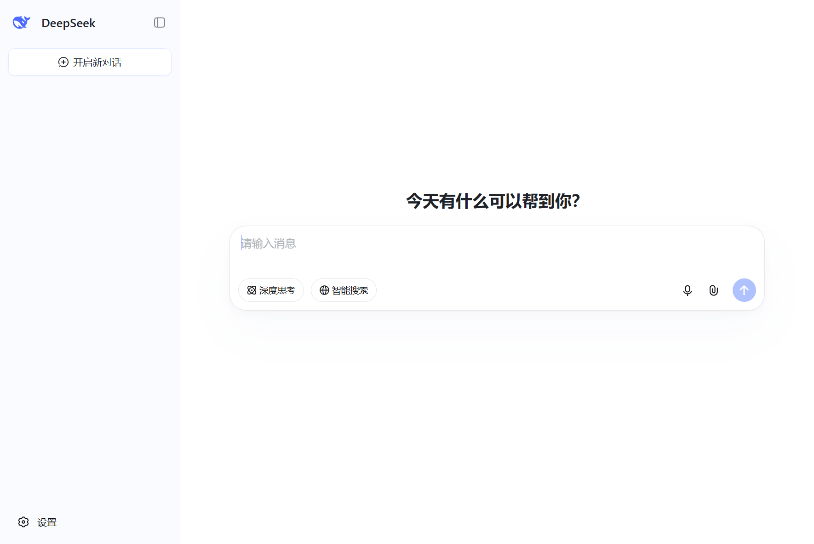

# DeepSeek Chat Desktop（非官方）

> **非官方项目**：这是 [deepseek-ai/chat-demo](https://github.com/deepseek-ai/chat-demo) 的 Windows 桌面封装，与 DeepSeek 官方无关。
> 官方从未发布过桌面客户端，本项目只是把官方的静态示例套进了 Electron 外壳。

把 DeepSeek 官方的 `chat-demo` 打成一个可以双击运行的 Windows 客户端：不用开浏览器、不用起本地服务、有独立窗口和图标、聊天记录保存在本机。



## 这是什么

chat-demo 本身是一个纯静态的 React 应用，浏览器里直连 `https://api.deepseek.com`，没有后端。
本项目做的事情很简单：

- 用 Electron 包一层原生窗口
- 内置一个只监听 `127.0.0.1` 的静态文件服务，把 `dist/` 伺服给窗口
- 换掉默认的界面字标和图标，让它看起来像个正经软件
- 打了一个 NSIS 安装包（免管理员权限、带卸载）

**没有**改任何请求逻辑、**没有**加中间层、**没有**收集数据。所有对话直接由你的机器发往 DeepSeek API。

## 特性

- 🖥 原生窗口，支持窗口位置/大小记忆、单实例运行
- 🔒 全部数据本地：API Key 和聊天记录都存在本机 Chromium 存储里，不经过任何第三方服务器
- 🎙 语音输入可用（内置服务给了正常的 http origin，麦克风权限是安全上下文下的）
- 🌗 跟随系统深浅色
- 📦 提供安装包（安装到 `%LOCALAPPDATA%\Programs\DeepSeek Chat`，无需 UAC）
- 🧹 卸载干净，但保留聊天记录

## 安装

从 [Releases](../../releases) 页面下载 `DeepSeek-Chat-Setup-x.y.z.exe`，双击安装。

> 请注意版本号，原则上是一定要用最新的版本，以防止一些奇奇怪怪的bug，记得及时更新到最新版本

安装包**没有数字签名**，Windows SmartScreen 可能提示"已保护你的电脑"，点「更多信息 → 仍要运行」即可。

装完第一次打开，在「设置」里填入自己的 [DeepSeek API Key](https://platform.deepseek.com/api_keys)。

### 卸载

设置 → 应用 → DeepSeek Chat → 卸载。

聊天记录在 `%APPDATA%\DeepSeek Chat`，卸载不会删除，需要彻底清干净请手动删掉这个目录。

## 从源码构建

环境要求：**Node.js ≥ 22.12**、Git、Bash（Windows 用 Git Bash 或 MSYS）。

```bash
# 1. 构建官方前端（clone + 装依赖 + 出 dist/）
bash scripts/build-web.sh

# 2. 装 Electron 外壳的依赖
cd desktop && npm install && cd ..

# 3. 开发模式跑起来
cd desktop && npm start
```

> 说明：官方 `npm run build` 里的 `NODE_ENV=production` 前缀在 Windows cmd 下会失效，所以 `build-web.sh` 里直接导出环境变量后再调 `rspack`。

### 打包

```powershell
# 1. 下载并解压 Electron 官方预编译包（含 electron.exe 的那个目录）
#    https://github.com/electron/electron/releases

# 2. 组装便携版目录 -> release\DeepSeek Chat\
powershell -ExecutionPolicy Bypass -File scripts\make-portable.ps1 -ElectronDir C:\path\to\electron

# 3. 编译安装包 -> release\DeepSeek-Chat-Setup-1.0.0.exe
powershell -ExecutionPolicy Bypass -File scripts\build-installer.ps1 -Makensis C:\path\to\makensis.exe -Version 1.0.0
```

没有 NSIS 的话，直接发第 2 步产出的便携版目录（打成 zip）也能用，双击 `DeepSeek Chat.exe` 即可。

> **别把程序放在 OneDrive 托管的目录里运行**，见下方已知问题。

## 项目结构

```
desktop/               # Electron 外壳
  main.js              # 主进程：内建静态服务、窗口管理、单实例锁
  package.json
  build/icon.ico       # 应用图标（多尺寸）
  web-overlay/         # 覆盖层：theme.css + logo.svg，注入 index.html
packaging/
  installer.nsi        # NSIS 安装包脚本
scripts/
  build-web.sh         # 构建官方前端到 repo/dist
  make-portable.ps1    # 组装便携版目录
  build-installer.ps1  # 编译安装包
repo/                  # 官方 chat-demo 源码（MIT），构建时克隆，不提交
docs/screenshot.png
```

## 实现细节

几个不那么显然的点，留给后来的人：

**为什么用本地 http 服务而不是 `file://`？**
`file://` 属于 opaque origin，`localStorage`/`IndexedDB` 行为不一致，麦克风也不在安全上下文里。起一个 `127.0.0.1` 的随机端口静态服务，窗口加载 `http://127.0.0.1:PORT`，上面这些就都正常了。

**数据存哪？**
Chromium 的用户数据目录（`%APPDATA%\DeepSeek Chat`）。窗口状态单独存 `window-state.json`，启动日志 `main.log`。

**界面定制怎么做的？**
不改官方源码，只在 `index.html` 里追加一个 `theme.css`，用 CSS 覆盖官方那套 hash 类名（`--dsw-static-blue-500` 之类的 token 直接改色），字标用 `::before` 画 logo、`::after` 写字。官方前端升级后类名变了，覆盖会失效，但不会崩溃。

## 已知问题

- **不要把程序放在 OneDrive 托管的目录里运行**（比如默认的"文档"）。实测从 OneDrive 路径启动 Electron 会直接 `0xC0000003` 崩溃、连日志都不产生。装到 `%LOCALAPPDATA%` 或任何普通磁盘目录就正常。
- 安装包/可执行文件未签名，SmartScreen 会拦一次。
- 界面覆盖层依赖官方前端类名，官方改版后需要同步。

## 隐私

- 没有后端、没有遥测、没有统计
- 你的 API Key 只存在本机，只发给 `api.deepseek.com`
- 唯一的网络请求来自官方前端本身（模型调用、联网搜索、附件上传）

## 协议

本项目代码以 **MIT** 发布。

前端来自 [deepseek-ai/chat-demo](https://github.com/deepseek-ai/chat-demo)，MIT，Copyright (c) 2026 DeepSeek，原始协议见 [官方仓库 LICENSE](https://github.com/deepseek-ai/chat-demo/blob/main/LICENSE)。

Electron / Chromium / FFmpeg 的再分发条款见随包附带的 `LICENSE`、`LICENSES.chromium.html`（FFmpeg 以独立 DLL 动态链接，符合 LGPL）。

**商标声明**：DeepSeek 名称与鲸鱼 logo 归 DeepSeek 所有。本项目使用它们仅为标识所连接的服务，不代表官方背书或关联。
